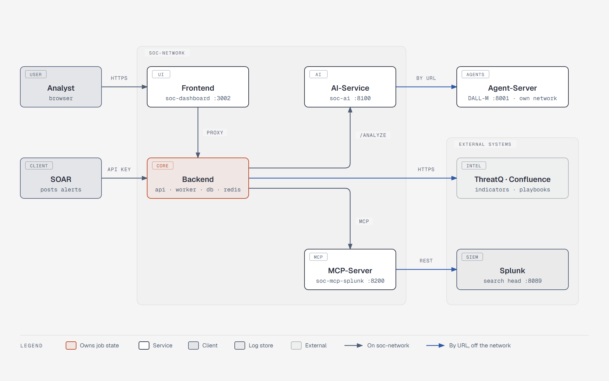

# Backend

The core of SOC AI Agent: the API, the queue worker, Postgres and Redis. It is
the only service that writes to the database and the only one that owns job
state. NestJS, Prisma, BullMQ.



## Run

```bash
docker network create soc-network     # once
cp .env.example .env                  # then fill in the secrets
docker compose up -d --build
```

- API: http://localhost:8082
- Swagger: http://localhost:8082/docs

To run the whole system, use the scripts in `deploy/` instead of writing `.env`
by hand:

| Script | Use |
| --- | --- |
| `./deploy/dev-setup.sh` | Writes `.env` for Backend, AI-Service and MCP-Server with matching tokens. |
| `deploy/dev.yml` | Compose file for the local stack: Backend, AI-Service, Frontend. |
| `./deploy/vps-demo.sh` | Deploys all five repos on an Ubuntu VPS. |

## Containers

| Container | Role |
| --- | --- |
| `soc-core-api` | HTTP API. `APP_ROLE=api`. |
| `soc-core-worker` | Consumes the `analysis` queue. `APP_ROLE=worker`. |
| `soc-db` | Postgres 16. |
| `soc-core-redis` | Redis 7, the queue. |

## API

| Route | Credential | Purpose |
| --- | --- | --- |
| `POST /v1/analyze` | `X-API-Key` | Submit an alert. Returns a job. |
| `GET /v1/results`, `/v1/results/:id`, `/v1/jobs/:id` | `X-API-Key` | Read jobs and results. |
| `POST /auth/login`, `/auth/refresh`, `GET /auth/me` | none, then JWT | Dashboard sign-in. |
| `/admin/users`, `/admin/api-keys`, `/admin/audit-logs`, `/admin/stats` | JWT, admin role | Administration. |
| `GET /health` | none | Liveness. |

## What it calls

| Service | Setting | For |
| --- | --- | --- |
| AI-Service | `AI_SERVICE_URL`, `AI_SERVICE_AUTH_TOKEN` | Run an agent, match a playbook. |
| MCP-Server | `SPLUNK_MCP_URL`, `MCP_AUTH_TOKEN` | Search Splunk. |
| ThreatQ | `THREATQ_*` | Look up indicators. |
| Confluence | `CONFLUENCE_*` | Read the playbook pages. |

`AI_SERVICE_AUTH_TOKEN` and `MCP_AUTH_TOKEN` must have the same value here and
in the other repo's `.env`. Every setting is explained in `.env.example`.

`SPLUNK_LOOKUP_MODE` controls the Splunk stage: `off`, `manual` (the analyst
presses a button), or `auto`.

## Splunk catalogue

`catalog/splunk-catalog.json` lists the indexes, sourcetypes and field names the
searches use. It is built into the image, so a change needs a rebuild. If it
does not match Splunk, a search returns zero rows without an error. How to
export and review it: [docs/splunk-catalog.md](docs/splunk-catalog.md).

## Database changes

Change the schema only through `prisma/migrations/`:

```bash
# edit prisma/schema.prisma, then
npx prisma migrate dev --name <what-changed>
```

Read the generated SQL and commit it. Do not use `prisma db push`: on a database
with data it drops whatever the schema no longer mentions.

## Tests

The suite in `tests/` runs against a running API.

```bash
pip install -r tests/requirements.txt
export SOC_BASE_URL=http://localhost:8082
SOC_API_KEY=<key> pytest                 # everything; submits real jobs
SOC_API_KEY=<key> pytest -m "not e2e"    # no waiting on the model
```

## More

| Topic | File |
| --- | --- |
| Production setup | [docs/setup.md](docs/setup.md) |
| Credentials per service | [docs/tokens.md](docs/tokens.md) |
| Connecting a company Splunk | [docs/splunk-mcp.md](docs/splunk-mcp.md) |
| Troubleshooting a wrong answer | [docs/testing.md](docs/testing.md) |
| Design rationale | [docs/restructure.md](docs/restructure.md) |
| Source layout, auth internals, deploy jobs, dependency security | [docs/reference.md](docs/reference.md) |
| The whole system | [../README.md](../README.md) |
